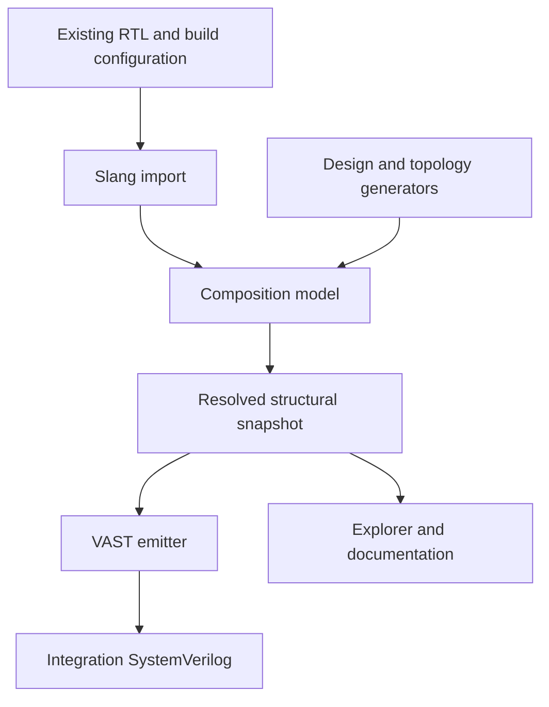

# Executable Hardware Specification Product Plan

Build a reusable library for constructing hardware modules and complete SoCs from existing RTL/IP and generated components. Running a design package resolves a selected configuration and produces integration SystemVerilog, an interactive structural explorer, and module documentation from the same executable design.

The baseline is a hard fork of Topstitch, Slang for SystemVerilog import, and xlsynth-vast for structured RTL emission. CIRCT and LLVM are outside the baseline. The first release targets one known router and component family, with a short development loop, distributed as a Rust crate with Slang linked in.

Status: implementation handoff, 12 October 2026; implementation has not started. Working name: Topstitch fork. The public product name remains undecided; do not adopt Archstitch, which understates the hardware construction scope. Release dates remain unset.

## Product and first customer

The first customer is an ASIC architect or integration engineer assembling reusable RTL blocks into configurable subsystems. Today, topology scripts, integration RTL, block diagrams, and documentation can encode the same design independently. The product makes structural composition executable and generates those outputs together.

The primary promise is: describe the composition once, build a selected configuration, and inspect the exact structure used to generate its integration RTL.

A component can be an opaque RTL leaf or a generated composition. Small hardware modules, CPU frontends and backends, compute tiles, generated NoCs, and complete SoCs use the same recursive composition mechanism. Each generated module can become a reusable component in a larger design. Users choose meaningful boundaries; the explorer stops at opaque leaves. The product constructs integration hardware as well as describing its architecture.

“Executable spec” initially means executable structural construction and checks. It does not imply cycle simulation, protocol correctness, or proof that leaf implementations satisfy their descriptions.

## First user workflow

1. Import the known router, core, cache, and memory endpoint definitions using their existing RTL source configuration.

1. Describe interface groupings once where the RTL exposes separate signals. Reference imported ports rather than copying port declarations.

1. Write or reuse generators for a compute tile and a mesh. Select dimensions, component parameters, and endpoint assignments.

1. Build a configuration. Resolve port widths, expand generated instances, and check connections.

1. Emit integration RTL and a build manifest referencing the original leaf RTL.

1. Open the explorer, expand a tile, select an interface, and inspect its endpoints, widths, parameters, and source references.

1. Export the same information as browsable module documentation and use the generated RTL in the existing ASIC flow.

The first example is a small mesh connecting repeated compute tiles and memory endpoints. A second configuration changes mesh dimensions and core count without editing emitted RTL or diagrams. Before implementation begins, select a redistributable representative router and its source configuration, then record the SystemVerilog constructs its real interface requires. Simplified core fixtures are acceptable; a fake scalar-only router interface cannot establish compatibility with the intended family.

## Product surface

| Deliverable | First release |
| --- | --- |
| Composition library | Define, import, instantiate, connect, expose ports, resolve, validate, and export |
| Generator package | A mesh and a nested compute tile built around one known component family |
| Command line interface | Open (#9): designs build with Cargo; whether serving the explorer needs a small binary is undecided |
| Explorer | Hierarchy navigation, interface selection, connection tracing, search, and an inspector |
| Documentation | Module descriptions, parameter values, interface tables, hierarchy views, and diagnostics |
| Release package | The library crate with Slang built from vendored source, and browser assets, for the initial supported platform |

The first release is Rust-first: designs and generators are authored in Rust against the library API and built with Cargo. Language bindings, including Python, are deferred. When added, a binding is a thin authoring API over native functionality; it must not become a separate model implementation or a broad API-design project before the core workflow works.

## Technology and reuse

| Area | Reuse | Work we own |
| --- | --- | --- |
| Composition | Hard-fork Topstitch | Product-facing errors, structural export, and targeted model extensions |
| RTL import | Slang, linked in-process from pinned vendored source, under a forked slang-rs | Import configuration, caching, source provenance, supported-type policy, and a narrow C++ shim ([Slang in-process](design/slang-in-process.md)) |
| RTL output | xlsynth-vast | Mapping the resolved composition to the existing AST emitter |
| Browser UI | React and TypeScript with React Flow | Hardware blocks, interface views, hierarchy navigation, and inspection |
| Layout | ELK.js; generator-provided mesh coordinates | Layout settings and hardware-specific presentation |
| Serialization | Serde and JSON | A small versioned structural snapshot |
| Distribution | Cargo | The library crate with vendored Slang, and explorer assets |
| Language bindings (deferred) | PyO3 and Maturin for Python, when needed | A narrow binding surface over the Rust API |
| Documentation | Existing Markdown and HTML rendering components | Templates driven by the structural snapshot |

Topstitch 0.100.0 declares xlsynth-vast and slang-rs dependencies. The XLSynth project describes xlsynth-vast as a standalone Rust-native AST builder and emitter that does not require libxls. Preserve this dependency separation in the fork. [Topstitch dependencies](https://docs.rs/crate/topstitch/0.100.0/source/Cargo.toml.orig) · [XLSynth project structure](https://github.com/xlsynth/xlsynth-crate)

React Flow supplies interactive node and edge UI; ELK.js supplies layout algorithms. These are the proposed starting components, subject to a representative hierarchy and port-layout check. Build hardware semantics and navigation ourselves, rather than a new generic graph renderer or layout solver. [React Flow](https://reactflow.dev/) · [ELK.js](https://github.com/kieler/elkjs)

Reuse compatible upstream fixes and retain required notices. Pin the fork and dependencies for releases. A hard fork gives control of the product API without requiring a broad rewrite of working upstream code.

## Architecture

The fork remains the authoritative construction model. Add a read-only resolved snapshot for consumers; do not introduce a second independently mutable graph. Defining resolved connectivity is a core engineering task, not merely serialization. Where connection normalization currently happens inside emission, extract reusable resolution logic so RTL emission and explorer tracing consume the same mappings.

The snapshot contains module definitions, instances, resolved parameters, ports and types, interface membership, connections, source references, descriptions, and stable object keys. Store topology coordinates as optional presentation hints. Keep view state separate from hardware connectivity.

Before UI implementation, specify and test the following connection contract, reusing Topstitch semantics where available:

| Case | Required meaning and example |
| --- | --- |
| Bit ranges and concatenation | Preserve explicit bit ordering; for example, destination bits 7 through 4 map to source A bits 3 through 0, and destination bits 3 through 0 map to source B bits 7 through 4 |
| Fan-out and net membership | One source can drive multiple compatible sinks; all views retain that shared source |
| Constants | Preserve value, width, and the exact destination slice |
| Open and unused ports | Distinguish intentionally open or unused endpoints from missing required connections |
| Hierarchy boundaries | Record how an exposed parent port maps to child endpoints so tracing crosses a boundary without inventing connectivity |

Reject unsupported forms explicitly. These examples define structural behavior; they do not infer a signal path through an opaque RTL leaf.

Maintain source module definitions, resolved specializations, and individual instances as distinct identities. Multiple specializations of one RTL module must coexist without naming collisions while preserving original module references and parameter overrides. Keep vector connections compact. Preserve hierarchy and render the current scope or selected neighborhood rather than expanding the entire design on screen.

## Generator and API contract

A generator is an ordinary function that constructs and returns a component. Generated components can be instantiated by other generators. A mesh generator owns mesh connectivity; a design-specific NoC package owns endpoint addressing, routing configuration, and any required tables. The generic engine handles construction and structural validation.

The public vocabulary stays small:

| Operation | Meaning |
| --- | --- |
| Import | Obtain an RTL component signature under a specified source and parameter configuration |
| Instantiate | Add a named occurrence of an imported or generated component |
| Connect | Connect compatible signals or interface members |
| Expose | Make a child endpoint available at the enclosing component boundary |
| Elaborate | Resolve one hardware design configuration into concrete structure |
| Check | Return structural diagnostics with object references |
| Export | Emit RTL, structural data, or documentation |

Connecting endpoints never silently inserts conversion hardware. Width adapters, bridges, and clock-crossing components are ordinary instances. Interface groupings are metadata over real endpoints; they must not hide direction or width mismatches.

Architectural expansion and RTL elaboration are distinct: generators expand the topology; Slang resolves SystemVerilog declarations for each relevant IP configuration. Cache import results by source content, compiler configuration, parameters, and tool version. Repeated instances of the same specialization reuse the imported result. Per-router coordinates, IDs, or routing parameters may create distinct configurations even when port shapes are identical. Measure this workload before optimizing; do not omit supposedly non-shape parameters from the cache key without establishing that reuse is sound.

Use stable local names and explicit instance paths, not memory addresses, for exported identity. Document that renaming or moving an instance changes its path. Snapshot schemas carry a version; consumers reject unsupported semantic versions. Keep Topstitch internals private and expose the agreed operations rather than every upstream method. Treat the API as experimental until the reference designs exercise it.

## Import and correctness boundary

The first release imports component signatures for composition: ports, resolved widths, relevant types, parameter values, and source references. The import input includes ordered sources, packages, include paths, defines, top module, and parameter overrides. Slang owns parsing, type checking, and RTL elaboration; the product does not implement a SystemVerilog frontend. [Slang Rust integration](https://github.com/xlsynth/slang-rs)

Use the selected router's actual packages, port types, arrays, type parameters, and interfaces to establish the required supported subset before designing the structural export. Import that configuration first and publish the constructs supported by the pilot. Unsupported interface constructs must produce a clear diagnostic; never silently drop ports in an RTL-generating build.

Existing-design structural import is a later capability. Importing hierarchy alone is insufficient to establish connectivity. That feature must also resolve instance bindings, aliases, slices, concatenations, and supported wiring expressions, with explicit unknowns outside its scope.

Before writing RTL, check missing required connections, conflicting drivers, incompatible directions or widths, invalid slices, names, and hierarchy boundaries. Return structured diagnostics for ordinary design errors. Generate the RTL and documentation from the same build snapshot and record its identity in the output manifest.

Topstitch already has relevant negative validation tests and slice/bit-order emission tests. Preserve these, then add targeted tests for the fork's structural export and representative IP. [Validation tests](https://docs.rs/crate/topstitch/latest/source/tests/checks/validate.rs) · [Emission tests](https://docs.rs/crate/topstitch/latest/source/tests/emit.rs)

## Explorer experience

The default screen shows the selected system scope, a hierarchy tree, and an inspector. Blocks expose named interfaces; wires are bundled by interface until the user requests signal detail.

Users can enter a generated component, navigate back through breadcrumbs, search for an instance, select a connection, and follow it through hierarchy boundaries. Use semantic zoom: entering a block reveals an appropriate view of its internal structure rather than simply enlarging the drawing. The inspector shows concrete parameters, widths, endpoints, descriptions, and source provenance from the exact build used for RTL emission.

For a mesh, honor the generator's logical coordinates. For other compositions, provide useful automatic layout with optional hints for grouping, port placement, labels, and saved view adjustments. Reuse presentation templates per component family and parameterization instead of hand-positioning every instance in each SoC. Keep hardware structure, optional presentation metadata, and authored explanations distinct; all presentation references stable objects in the resolved snapshot and never duplicates connectivity definitions. Moving a block changes only its presentation. Opaque IP remains an explicit boundary: the viewer must not imply an internal path or behavior that has not been described.

The initial explorer is read-only with respect to hardware. The [ET-SoC-1 interactive diagram](https://spacesheep.dev/@yaroslavvb/et-soc1-chip-diagram) is an interaction reference for chip-like logical views, semantic drill-down, breadcrumbs, and contextual explanations; it is not a source of verified RTL structure or an implementation dependency. The initial visual target is the generated mesh system with compute tiles and memory endpoints, drill-down into one tile, bundled interfaces, and a selectable connection inspector. Visual circuit editing, multiplayer collaboration, physical floorplanning, and arbitrary gate-level inspection are outside the first release. Guided stories and animated transaction flows are later optional features: they require authored scenarios or imported traces, since connectivity alone does not establish runtime behavior, latency, or bandwidth. No general storytelling framework is needed for the first release.

## ASIC flow integration

| ASIC activity | Product role |
| --- | --- |
| Architecture exploration | Generate and inspect alternative component counts and topologies |
| IP integration | Resolve existing IP signatures and emit wrapper instantiations and wiring |
| Review | Show the actual built structure with interface details and module documentation |
| RTL verification | Supply wrappers, original leaf sources, and the build manifest to existing tools |
| Synthesis and physical design | Hand off conventional SystemVerilog through the project's established flow |

The product owns generated composition RTL. Existing leaf RTL remains external and unchanged. Generated files are reproducible outputs; users edit the generator or input configuration.

Simulation, lint, CDC/RDC, protocol verification, synthesis, and signoff remain necessary. Structural checks catch integration errors but do not establish temporal behavior or implementation correctness.

## Distribution and development loop

The proposed first supported target is Linux x86-64. Sandstitch ships as a Rust crate; language bindings follow later. Slang is compiled from pinned vendored source and linked statically, so the import does not depend on a `slang` binary on the user's `PATH`, and its JSON format, but on the exact version the crate was tested with. Pin the fork, the vendored Slang version, the Rust toolchain version, and the build requirements: GCC 11 or Clang 17, CMake 3.20 and Python 3. The C++ standard library is linked dynamically, so the minimum runtime is the libstdc++ of GCC 11 and the glibc of the oldest supported host. See [Slang in-process](design/slang-in-process.md).

The first build of a design compiles Slang once (minutes); Cargo's build cache and, when installed, ccache make later builds reuse it, including across `cargo clean` and other projects. The build never downloads sources. Unsupported compilers fail with a clear message before compiling Slang. Ordinary CI caches the compiler output instead of running a separate native build job. Build browser assets only for relevant changes or releases. Whether serving the explorer needs a small binary is open (#9).

There is no LLVM/CIRCT build in the baseline. Benchmark both repeated identical specializations and unique per-router configurations. Record Slang invocation count, cold and warm import time, construction/check/export time, peak memory, cold and warm CI duration, package size, and browser loading separately. Establish regression budgets from these representative workloads before expanding scope; do not substitute an unmeasured performance promise.

## Delivery milestones

| Milestone | Deliverable | Exit condition |
| --- | --- | --- |
| 1 Packaged real IP baseline | Pinned hard fork and dependencies, existing emitter, representative router import, and Slang linked in-process | Select the router before implementation; import its required types; emit one design containing two parameter specializations and repeated instances of each; elaborate with original RTL and verify widths, overrides, and names; import with Slang built from pinned vendored source, without an external `slang` binary |
| 2 Resolved connection contract | Executable connection examples, read-only snapshot, provenance, and structured diagnostics | Bit mappings, fan-out, constants, open ports, and nested exposed ports have precise semantics; emission and tracing share those mappings; independent expected connections or downstream simulation catch shared normalization mistakes; two differently configured generated components coexist correctly |
| 3 Working reference NoC | Mesh, nested compute tile, two system configurations, and required routing/configuration artifacts | Original RTL plus wrappers elaborate; end-to-end traffic crosses multiple routers and reaches the intended memory endpoint in both configurations; routing artifacts are recorded in the manifest; repeated and unique parameter workloads are measured |
| 4 Explorable specification | Browser explorer and generated module documentation | A reviewer can navigate from mesh to tile with breadcrumbs, expand bundled interfaces, trace selected connections, and inspect concrete properties from the same build; both reference configurations render without per-instance manual layout; UI work starts after the connection contract passes |
| 5 Pilot release | Packaged CLI/API, examples, compatibility policy, and measured regression budgets | The oldest supported clean environment can build a design with the documented toolchain (Rust, C++ compiler, CMake, Python 3), import, check, emit, and browse (packaging revisited in #9); representative correctness and performance checks pass |

Deliver a vertical slice through import, composition, emission, and inspection before broadening component support. Do not make API freeze, general plugin design, or additional output backends prerequisites for that slice.

Acceptance includes useful diagnostics for deliberately broken wiring, no silent unsupported-port omissions, simultaneous mixed specializations, and reproducibility from the recorded configuration. For a small design, use an independently specified connection map or distinct bit patterns in a downstream simulator, covering fan-out, a nontrivial slice/concatenation, and an exposed nested port. Agreement between JSON and RTL from the same normalization is insufficient by itself. No general RTL-comparison engine is required for this test. A fixture without implemented routing may demonstrate composition, but cannot satisfy the working-NoC milestone.

## Later capabilities

**Structural comparison.** Import a separately maintained RTL implementation and compare it with the intended architecture at selected boundaries. Report missing connections, width differences, parameter mismatches, and unexpected instances. Align objects through explicit mappings when names or hierarchy differ. Adapters remain ordinary components; acceptance rules live in a checking layer.

**Additional reuse.** Add ring/tree generators and more component families when projects need them. Add project-specific input adapters without requiring a universal IP-XACT catalog. Use existing documentation and verification tooling through ordinary build artifacts before adding deep integrations.

**Lean integration.** Define a precise structural semantics and attach named properties to components or generators. A first proof target could be distinct endpoint assignment or mesh reachability under explicit assumptions. Proving one resolved snapshot differs from proving every configuration of a generator. A Lean proof about the model does not automatically prove VAST emission or leaf RTL correctness; those require separate correspondence arguments.

**CIRCT.** Reconsider only if a concrete compiler transformation or interoperability requirement warrants it. It is not a planned dependency or a prerequisite for an executable structural spec.

## Immediate decisions

Proceed with the hard fork, preserve the VAST emitter, reuse Slang, and make the structural snapshot the shared contract for the explorer and documentation. Use React Flow and ELK.js as the initial UI and layout candidates. Author designs in Rust first; defer language bindings and keep them thin when added.

Before implementation, choose the redistributable representative router and source configuration. Milestone 1 then verifies its real interface and pins the upstream revision, native dependency combination, Rust toolchain version, and runtime baseline. Define and test the resolved connection contract before implementing the explorer. These are focused entry and exit conditions for the agreed architecture, not a new language or compiler selection exercise.
